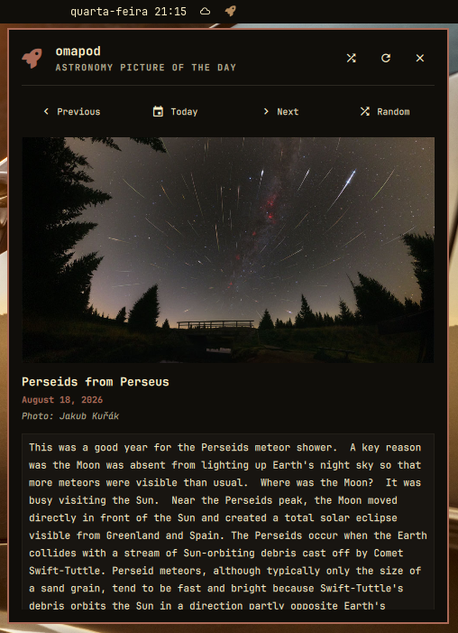

# 🚀 omapod

[](https://opensource.org/licenses/MIT)
[](https://omarchy.org)
[](https://quickshell.outfoxxed.me/)

> **omapod** is an interactive **NASA Astronomy Picture of the Day (APOD)** status bar widget and rich popup viewer for **Omarchy Linux** (Hyprland / Quickshell).

Explore daily astronomical wonders, watch space videos with inline transport controls or external MPV player, travel back through decades of NASA history, apply 1-click wallpapers, and copy high-res images directly to your clipboard.

<p align="center">
  
</p>

---

## ✨ Features

- 🚀 **Classic Rocket Icon in Status Bar:** Clean, unmistakable Nerd Font rocket (`nf-fa-rocket` / ``) icon on the top status bar.
- 🌌 **Detailed Astronomy Popup Panel:**
  - High-definition astronomy photos with aspect-fit rendering.
  - **Inline & External Video Player:** Direct MP4 videos play seamlessly inside the card with seek bar, time display, play/pause and volume controls; YouTube/Vimeo streams launch directly in MPV player.
  - Clean layout with formatted title, accent date right under the title, and scientific explanations.
- 🧭 **Time Navigation:**
  - **Previous (◀):** Navigate back through decades of NASA astronomy history (all the way to June 16, 1995).
  - **Today (📅):** Return instantly to today's featured media.
  - **Next (▶):** Advance forward (automatically disabled and dimmed on today).
  - **Random (🔀):** Discover fascinating random astronomy photos.
- 🖼️ **1-Click Wallpaper:** Set any APOD image as your Omarchy desktop background (strictly on-demand via the Wallpaper button).
- 💾 **Save to Pictures:** Export HD images directly to `~/Pictures/NASA_APOD/`.
- 📋 **Copy Image to Clipboard:** Direct binary image copying via `wl-copy` to paste directly into Discord, Telegram, GIMP, Slack, etc. (automatically disabled on videos).
- 🌐 **Robust Dual Backend:** NASA API with automatic zero-rate-limit fallback to the official NASA APOD HTML archive (`apod.nasa.gov`).
- ⚡ **Smart Cache:** Caches metadata and media locally in `~/.cache/omarchy-omapod/`.

---

## 📋 Requirements

Ensure the following dependencies are installed on your Omarchy system (most come pre-installed):

- **Python 3.9+** (with standard library)
- **Quickshell / Qt 6 Quick & QtMultimedia**
- **Nerd Font** (e.g. *JetBrainsMono Nerd Font*)
- **wl-clipboard** (`wl-copy` / `wl-paste` for clipboard copy)
- **mpv** & **yt-dlp** (for smooth video playback)
- **swww** or **hyprpaper** (for setting desktop wallpaper)
- **ffmpeg** (optional, for video frame thumbnail extraction)

To verify / install on Arch/Omarchy:
```bash
sudo pacman -S --needed python mpv yt-dlp wl-clipboard ffmpeg
```

---

## 🚀 Installation

### 1. Clone the repository into your Omarchy plugins folder:

```bash
git clone https://github.com/jvlianodorneles/omapod.git ~/.config/omarchy/plugins/dorneles.omapod
```

### 2. Add the widget to your status bar configuration:

Edit `~/.config/omarchy/shell.json` and add `dorneles.omapod` to your preferred bar section (`"left"`, `"center"`, or `"right"`):

```json
{
  "bar": {
    "center": [
      {
        "id": "dorneles.omapod"
      }
    ]
  }
}
```

### 3. Reload Omarchy Shell:

```bash
omarchy-shell shell rescanPlugins
omarchy restart shell
```

The rocket icon will now appear in your status bar!

---

## ⚙️ Configuration & Customization

You can customize **omapod** by adding options to `dorneles.omapod` in `~/.config/omarchy/shell.json`:

```json
{
  "id": "dorneles.omapod",
  "displayFormat": "icon_only",
  "iconStyle": "rocket",
  "apiKey": "DEMO_KEY"
}
```

### Available Settings:

| Key | Type | Default | Description |
|---|---|---|---|
| `displayFormat` | string | `"icon_only"` | `"icon_only"` (rocket icon only) or `"icon_title"` (icon with truncated title). |
| `iconStyle` | string | `"rocket"` | Icon style: `"rocket"` (Classic Rocket), `"rocket_launch"` (Rocket Launch), `"telescope"` (Telescope), `"planet"` (Planet), `"star"` (Star). |
| `apiKey` | string | `"DEMO_KEY"` | NASA API Key (default `DEMO_KEY`, or your own free key from [api.nasa.gov](https://api.nasa.gov)). |

---

## ⌨️ Keyboard Shortcuts (Inside Panel)

When the **omapod** panel is open, use these convenient shortcuts:

| Key | Action |
|---|---|
| <kbd>Space</kbd> or <kbd>P</kbd> | Play / Pause video |
| <kbd>M</kbd> | Mute / Unmute video audio |
| <kbd>V</kbd> | Open video in external MPV Player |
| <kbd>Esc</kbd> | Close popup panel |
| <kbd>←</kbd> (Left Arrow) | Previous day |
| <kbd>→</kbd> (Right Arrow) | Next day (disabled on Today) |
| <kbd>T</kbd> | Today's picture |
| <kbd>R</kbd> | Random astronomy picture |
| <kbd>W</kbd> | Set current image as desktop wallpaper |
| <kbd>S</kbd> | Save image to `~/Pictures/NASA_APOD/` |
| <kbd>C</kbd> | Copy image to clipboard |
| <kbd>B</kbd> | Open official NASA webpage in default browser |

---

## 🖱️ Mouse Controls

- **Left-Click / Right-Click (Bar Icon):** Toggle the **omapod** popup panel.
- **Middle-Click (Bar Icon):** Fetch and display a random astronomy picture immediately.

---

## 💻 CLI / IPC Commands

You can control **omapod** from the terminal, custom keybindings, or scripts via `omarchy-shell`:

```bash
# Toggle / Open / Close the popup panel
omarchy-shell dorneles.omapod toggle
omarchy-shell dorneles.omapod open
omarchy-shell dorneles.omapod close

# Fetch pictures
omarchy-shell dorneles.omapod refresh   # Force refresh today's picture
omarchy-shell dorneles.omapod random    # Discover random picture

# Media actions
omarchy-shell dorneles.omapod play       # Play video
omarchy-shell dorneles.omapod wallpaper  # Set current picture as wallpaper
omarchy-shell dorneles.omapod save       # Save HD picture to ~/Pictures/NASA_APOD
omarchy-shell dorneles.omapod copy       # Copy image to clipboard
omarchy-shell dorneles.omapod browser    # Open NASA webpage in browser
```

---

## 🗑️ Uninstallation

If you ever wish to remove **omapod**:

1. Remove the `"id": "dorneles.omapod"` entry from `~/.config/omarchy/shell.json`.
2. Delete the plugin and cache directories:
   ```bash
   rm -rf ~/.config/omarchy/plugins/dorneles.omapod
   rm -rf ~/.cache/omarchy-omapod
   ```
3. Restart Omarchy Shell:
   ```bash
   omarchy restart shell
   ```

---

## 📄 License

This project is licensed under the **MIT License** - see the [LICENSE](LICENSE) file for details.

NASA APOD data, images, and explanations are credited to [NASA / APOD](https://apod.nasa.gov/apod/) and the respective photographers and astrophysicists.
